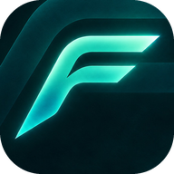

<p align="center"></p>

# Fjord Vision — screen color filters for games

By [fjord.wtf](https://fjord.wtf). Formerly called Vivid.

Fjord Vision changes the colors of your whole screen, the way the old NVIDIA game filters worked: brightness, contrast, saturation, hue and a night-vision shadow lift. It has built-in presets, your own profiles, hotkeys that work in game, and a black holo for Rust.

Fjord Vision only changes colors at the display level. It never opens, reads or modifies a game's files or memory, and it doesn't inject anything into a game. The black holo works from what's on your screen, like recording or streaming software does.

## Running it

1. Download `Fjord-Vision.exe` from the [latest release](https://github.com/zoxquie/vivid/releases/latest) and double-click it. There's nothing to install. It needs 64-bit Windows 10 or 11 (it uses the .NET Framework 4.8 that comes with Windows). Keep it in a folder you own, like Downloads or Documents, so it can update itself.
2. The exe isn't code-signed, so Windows SmartScreen may say "Windows protected your PC". Click **More info**, then **Run anyway**.
3. Pick a preset on the left or move the sliders on the right. Changes show in the big preview in the middle first: **Before** is the picture with no filter, **After** is the preset or edits you're looking at (drag the line to compare). Press **Apply** to put them on screen and save them, or **Discard** to drop them. Turn on **Apply instantly** to skip that step. Hotkeys and the tray menu always apply straight away.

Closing the window keeps Fjord Vision running in the tray so your filters stay on. To quit, right-click the tray icon and choose **Quit**. Quitting always puts your screen back to normal.

## Features

- **Filters:** Brightness, Contrast, Saturation, Hue rotation and Night vision. Click any number to type a value, double-click a slider to reset it, or use **Reset section** to reset a whole card.
- **Presets:** Grass, Winter, Desert and Night Vision, each with its own picture in the preview. If you edit a preset, your changes go into **Custom** and the preset itself stays the same.
- **My profiles:** **Save as profile** stores the current values. Use a profile's ⋯ menu to rename, duplicate, bind a key, export or delete it.
- **Import / Export:** Profiles can be shared as `.json` files or as a one-line share code (`VIVID1:…`) you can paste in Discord.
- **Hotkeys:** These work while the game has focus. The defaults are:
  - `F8`: filters on/off
  - `F9`: next profile
  - `Ctrl+F8`: black holo on/off

  Each profile can also have its own key. Pressing that key a second time turns filters off, so it's easy to compare with and without filters.
- **Black holo (Rust):** The **Holo** tab turns just the holosight's reticle black, in hip fire and when aiming. Nothing else on screen changes:
  - **Only where the holo is.** Aiming down sights, the reticle sits in the middle of the screen, so that circle is always watched. In hip fire it learns where the holo sits on your gun the first time you look around (about half a second of moving the mouse): the reticle stays in the same spot on screen while the world slides past, and anything that moves along with the world is ignored. Red and orange things anywhere else (wood, rust, skin, fire, barrels, signs) stay as they are.
  - **The whole reticle.** The reticle's own colour (bright and saturated, unlike lit red things in the world), its over-bright white-hot core, and its glow within 3 px all turn black, with a soft 1 px edge.
  - **How.** While Rust is in front, Desktop Duplication hands over each finished frame, a pixel shader swaps the reticle's colour and the result is shown in a click-through window that's left out of screen captures. Every pixel goes through the shader in the same frame, so the recolour stays on the reticle as it sways and recoils. A 16×16-pixel summary of each frame is read back (without waiting on the GPU) to find where the holo is. Pick the reticle color you use in Rust, what it turns into (black by default), and whether it only runs while Rust is in front. Rust has to be in borderless or windowed mode, and Windows 10 version 2004 or newer is needed.
- **Automatic updates:** Fjord Vision checks this repository's releases, downloads the new version and swaps it in place, whatever you named the file. A **Restart to update** button appears when it's ready. Turn it off or check by hand in **Settings → Updates**.
- **On-screen messages:** A short message appears when a hotkey switches something while you're in game.
- **Tray, start with Windows, start minimized, single instance.**

## Using your own screenshots

The preset cards and the live preview can show your own game screenshots instead of the built-in artwork.

- **In the app:** open a preset's ⋯ menu and choose **Set card image…**. To change the preview, right-click it and choose **Use my own screenshot…**, or use **Settings → Preview screenshot**. Your choices are saved in `%AppData%\Vivid\images`.
- **For everyone who runs your copy:** create an `images` folder next to the exe and put screenshots in it named `grass.jpg`, `winter.jpg`, `desert.jpg`, `night-vision.jpg`, `custom.jpg` or `preview.jpg`.
- **Built into the exe:** put the same files in `assets/presets` and rebuild.

Any preset without an image keeps the generated artwork.

## The two filter engines (Settings → Filter engine)

| | Screen matrix (default) | Gamma ramp |
|---|---|---|
| How | Windows' full-screen color matrix, the same mechanism as the Accessibility color filters | The monitor's gamma lookup table |
| Brightness / contrast | Yes | Yes |
| Saturation | Yes, including desaturation | Through NVIDIA Digital Vibrance (NVIDIA GPUs only) |
| Hue rotation | Yes | No |
| Night vision | Yes (always uses the gamma ramp) | Yes |
| Exclusive fullscreen games | Usually no; run the game in borderless or windowed mode | Yes |

**Strong night vision limited?** By default Windows limits how far gamma curves can move. Fjord Vision applies the strongest curve Windows accepts and tells you when it's capped. **Settings → Full gamma range → Unlock** sets the `GdiIcmGammaRange` registry value. This needs admin approval and a restart.

## Safety

- Fjord Vision records what it changed before it changes the display. If it ever crashes, the next launch puts your gamma and NVIDIA vibrance back the way they were. The screen-matrix effect ends on its own when the process exits.
- **Settings → Restore normal colors** resets everything right away.
- Settings live in `%AppData%\Vivid\settings.json` (the folder kept its old name so nothing is lost when you update). Errors, if any, are written to `error.log` in the same folder.
- Overlays and color filters are generally allowed, but every game sets its own rules. Check yours if you're unsure.

## Building from source

**On Windows** (with the .NET SDK installed):

```
dotnet build -c Release
```

The exe is written to `bin\Release\net48\Vivid.exe`.

**On Linux:**

```
sudo apt install dotnet-sdk-8.0 mono-devel
./build.sh
```

This writes `bin/Vivid.exe`. `tests/run.sh` runs the logic tests: the color matrix math, gamma ramps, settings and profile files, share codes and the holo reticle detection. `tests/gpu/check.sh` runs the holo's real shaders through Direct3D 11 (on Windows, or on Linux under Wine with `wine64`, `g++-mingw-w64-x86-64` and `xvfb`) and checks every pixel against the CPU matcher; screenshots dropped in `tests/gpu/shots` are checked too. `tests/gpu/run.sh` builds `bin/GpuSmoke.exe`, which does the same with the app's own Direct3D code (Windows only).

Code layout:

| File | What it does |
|---|---|
| `src/ColorMath.cs` | The filter math: the 5×5 matrix and the gamma curves |
| `src/ColorEngine.cs` | Applies filters through the matrix, gamma ramp or NVIDIA vibrance, and restores them |
| `src/NvVibrance.cs` | NVIDIA Digital Vibrance through `nvapi64.dll` |
| `src/Holo.cs` | The black holo: the colour rules, the CPU matcher used for the preview, `HoloZones` (finding where the holo is) and the overlay window and its thread |
| `src/HoloGpu.cs` | The black holo on the GPU: screen capture, the recolour shaders and the swap chain |
| `src/Overlays.cs` | The click-through overlay window and the on-screen messages |
| `src/AppController.cs` | App state, profiles and hotkeys |
| `src/AppInfo.cs` | Name, version, fjord.wtf link and the GitHub repo used for updates |
| `src/MainForm.cs`, `src/Pages.cs`, `src/Layout.cs`, `src/Widgets.cs` | The custom-drawn UI |

## Releasing a new version

Releases are built by GitHub Actions, and every copy of Fjord Vision (and of Vivid 1.3 and later) updates itself from the latest one.

1. Raise `Version` in `src/AppInfo.cs` (for example `1.5.0` → `1.5.1`).
2. Commit and push to `main`.

The workflow sees a version that hasn't been released yet, builds with `build.sh`, runs the tests and publishes release `v1.5.1` with two copies of the exe: `Fjord-Vision.exe` for new downloads and `Vivid.exe`, the name the built-in updater looks for. Pushes that don't change the version don't publish anything.

## Branding

The logo is `assets/brand/fjord-logo.jpg`. `python3 tools/make_icon.py` makes the app icon (`assets/fjord-vision.ico`), the window and tray icon (`assets/brand/window.ico`) and the badge drawn in the app (`assets/brand/mark.png`) from it.

Inside the code the app is still called Vivid: the assembly, the `Vivid.exe` build output, the `%AppData%\Vivid` folder and the single-instance names. Keep them, or copies installed before the rebrand stop updating.

To build locally on Linux: `apt install dotnet-sdk-8.0 mono-devel`, then `./build.sh` (tests: `tests/run.sh`).
